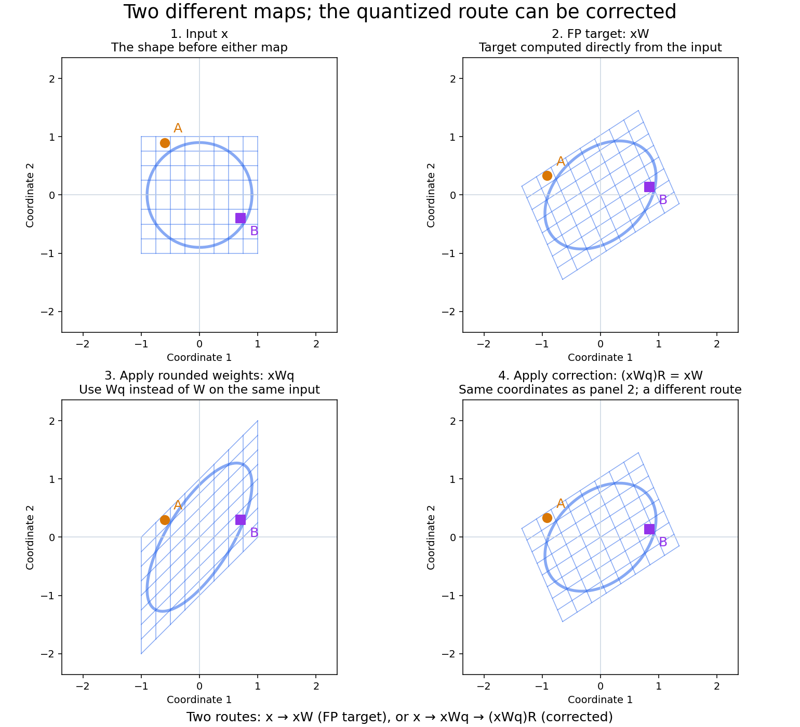
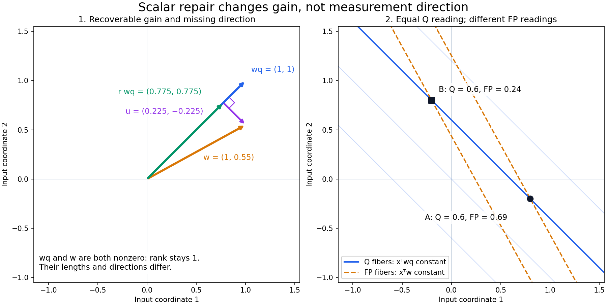
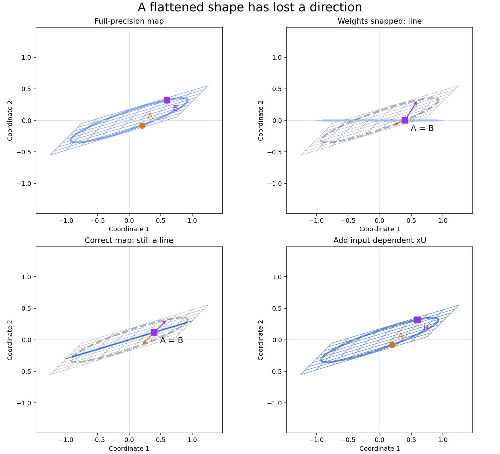
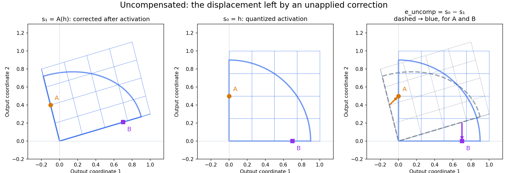
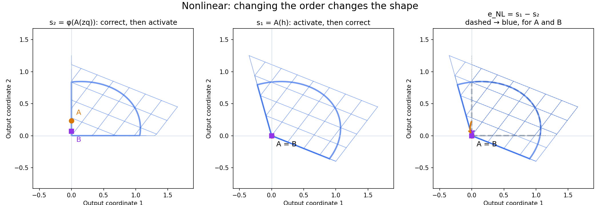
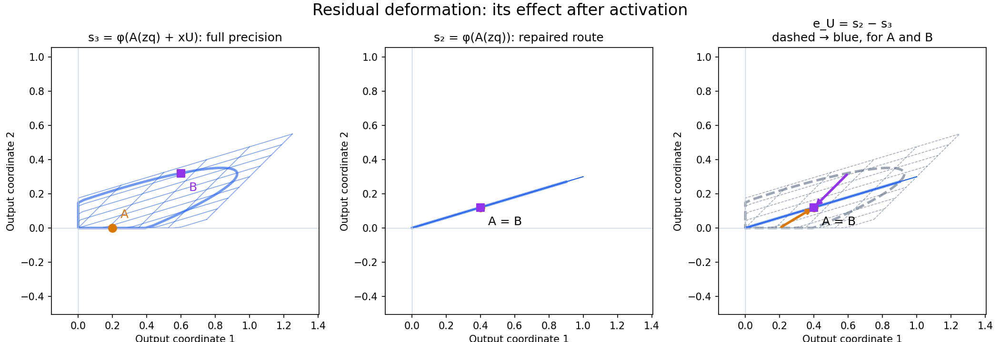
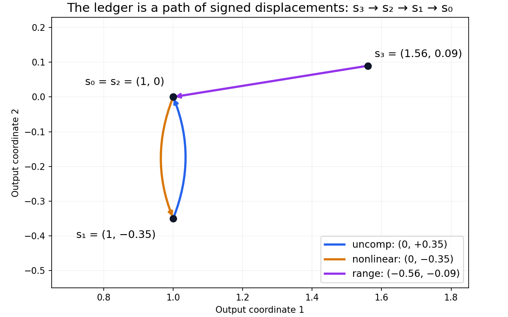

# Quantization geometry: maps, clipping, and an exact error ledger

A layer moves points. Before activation, it moves a grid into another grid and a circle into an ellipse, possibly flattened into a line. ReLU then presses negative coordinates onto the axes. Quantizing the weights changes the first motion; that can also change which points the second motion merges.

We want to distinguish three things: a deformation that a chosen correction could repair, a discrepancy caused by applying that correction on the wrong side of activation, and the output effect of an input direction the recovered map omits. The **ledger** is a record of signed vectors for those three comparisons, for each input. It accounts exactly for the observed output error. The pictures below show the states those vectors connect, rather than just their magnitudes.

## 1. What shape does the layer move?

Use row vectors: $x\in\mathbb R^{1\times n}$, weights $W,W_q\in\mathbb R^{n\times m}$, and shared float bias $b\in\mathbb R^{1\times m}$. The full-precision and quantized outputs are

$$
y(x)=\phi(xW+b),\qquad h(x)=\phi(xW_q+b).
$$

Here $\phi$ is coordinatewise ReLU, unless stated otherwise. Weight-only quantization replaces $W$ by $W_q$; it does not quantize the bias or activation. Each plotted grid line and circle consists of sampled inputs, with their identities preserved through every map. A and B mark two particular inputs. Coordinate scales stay fixed within each figure.

**Figure 1 — two routes to the same preactivation shape.** Panel 1 is the input. Panel 2 applies the original weights, giving the FP target. Panel 3 applies rounded weights **to that same input**, giving a different, more strongly sheared shape. Panel 4 applies R to the panel-3 shape and recovers the target. **Panels 2 and 4 are identical on purpose:** one computes xW directly; the other reaches the same coordinates through $(xW_q)R=xW$. Their difference is the route, not the result.

For this example,

$$
W=\begin{bmatrix}1&0.65\\-0.35&0.8\end{bmatrix},\qquad
W_q=\begin{bmatrix}1&1\\0&1\end{bmatrix},\qquad
R=\begin{bmatrix}1.35&-0.15\\-0.35&0.8\end{bmatrix}.
$$

The 2-bit quantizer rounds each coefficient to the nearest value in {−1,0,1}: 0.65→1, −0.35→0, and 0.8→1; 1 stays 1. Applying the new matrix gives the sheared shape in panel 3. Both maps preserve two input directions, and $W_qR=W$, so no additional input contribution is needed: U=0. Activation has not yet been applied; Figure 3 defines the post-activation ledger comparison.

## 2. Which part can a map on the quantized output recover?

### Start with one neuron: a measurement has a direction

Before considering a whole layer, take one neuron with no bias or activation. In this picture, write the input point x and weight vector w as **column vectors** in two dimensions. The neuron returns the scalar $x^\top w$. Its weight arrow tells us both **which input direction it measures** and **the gain of that measurement**.

Quantization changes w into wq. Generally, the arrow changes length and turns: the neuron now measures a different input direction with a different gain. Assume $w_q\ne0$. Suppose we keep only its quantized scalar output and try to repair it by multiplying by a scalar r. Can that put every input's response back where it should be?

Changing r stretches or reverses the arrow wq along its own line. It cannot turn it toward w. Consequently, exact repair for every input is possible precisely when w lies on that line:

$$
r\,x^\top w_q=x^\top w\quad\text{for every }x
\quad\Longleftrightarrow\quad w=r w_q.
$$

A parallel weight change can be repaired by changing gain. A change of direction leaves a part of the FP measurement outside the direction that this scalar correction can access.

**Figure 2 — a direction changes without a rank collapse.** On the left, the FP arrow w and the quantized arrow wq differ in length and direction. The green arrow rwq is the projection of w onto the line of wq: scalar gain can reach it. The purple arrow u supplies the remaining change of direction. On the right, each line is a **fiber**: all inputs on it give the same scalar response. A and B lie on one blue Q fiber but on different orange FP fibers. Any correction receiving just their shared Q reading must return the same answer for both, although FP requires different answers.

Here the bounded 2-bit quantizer changes $w=(1,0.55)^\top$ to $w_q=(1,1)^\top$. Both measurements have rank 1, as a nonzero scalar measurement in 2D must. **Quantization has rotated the fibers, not reduced the rank.** The distinction FP wants is now along a direction Q ignores.

### Recover the accessible part; name the part that remains

The closest arrow to w on the line of wq is its orthogonal projection. Call its scalar gain r and the remaining arrow u:

$$
r=\frac{w_q^\top w}{w_q^\top w_q},\qquad
w=r w_q+u,\qquad w_q^\top u=0.
$$

This is the least-squares repair of the weight direction: r minimizes $\|w-tw_q\|^2$ over scalar gains t. For each input, the same split becomes

$$
x^\top w=r\,(x^\top w_q)+x^\top u.
$$

The first term can be generated from the Q scalar alone. The second measures the input component along u, perpendicular to the direction Q measures. That is exactly the distinction lost when we keep only $x^\top w_q$.

A fiber has the formal definition $F_q(c)=\{x:x^\top w_q=c\}$. In the plane, it is a line perpendicular to wq. Multiplying the scalar by r changes the values assigned to these fibers; it cannot change which inputs share a fiber. If $u\ne0$, moving along u stays on a Q fiber but changes the FP reading, because $u^\top w_q=0$ while $u^\top w=\|u\|^2>0$. This proves that no function of the Q scalar alone can recover every FP response in this case.

For the highlighted points, $A=(0.8,-0.2)^\top$ and $B=(-0.2,0.8)^\top$:

$$
A^\top w_q=B^\top w_q=0.6,\qquad
A^\top w=0.69,\qquad B^\top w=0.24.
$$

The projection gives $r=0.775$ and $u=(0.225,-0.225)^\top$. The output-side repair therefore gives 0.465 for **both** points. To reach FP, A still needs +0.225 while B needs −0.225. Their shared Q scalar contains no way to choose between those two input-dependent additions.

### A layer is the same repair problem with several measurements

Return to the row-vector convention of Section 1. The columns of W are neuron weight vectors, and $xW_q$ is a collection of quantized measurements. A matrix R can mix and rescale those measurements. Unlike a scalar gain, it can use one measured direction to help repair another. What matters is whether the FP measurements can be expressed using the input directions **jointly** measured by Wq.

The geometric question stays the same: **how much of the FP response can we recover using only this quantized representation, without seeing x again?** R is the best linear correction through that channel. Let xU be the displacement still needed after that repair:

$$
xW=(xW_q)R+xU,\qquad W=W_qR+U.
$$

If two inputs have the same xWq, R must give them the same repaired output. The term xU can depend on input distinctions that this channel cannot see. In input-direction space, each column of U is perpendicular to the span of Wq's measured directions—the multivariate version of $u\perp w_q$. If Wq already spans all input directions, U=0 even when quantization has changed the map substantially, as in Figure 1.

To formalize “best,” minimize squared output displacement with equally weighted input directions:

$$
R\in\underset{T\in\mathbb R^{m\times m}}{\operatorname{argmin}}\;
\|W-W_qT\|_F^2,\qquad U=W-W_qR.
$$

For inputs uniformly distributed on the unit sphere, this is proportional to the average squared distance between xW and xWqT. As in the scalar projection, the residual is orthogonal to the available measured directions: $W_q^\top U=0$. This is orthogonality in input-direction space; it does not require the output displacements to be perpendicular for each sample.

### Derive the correction after identifying the repair channel

We have now specified what R and U should do. To calculate R, write $R=I_m+C$. The repair problem becomes

$$
\min_C\|W-W_q-W_qC\|_F^2.
$$

The exact Moore–Penrose inverse gives the minimum-norm correction increment $C=W_q^\dagger(W-W_q)$. This selects the R closest to leaving the output unchanged among equally good repairs. Substituting it into the residual definition gives

$$
R=I_m+W_q^\dagger(W-W_q),\qquad
U=(I_n-W_qW_q^\dagger)(W-W_q).
$$

Here $R\in\mathbb R^{m\times m}$ and $U\in\mathbb R^{n\times m}$. The scalar case is exactly this construction with one output: its R is r, and its U column is u.

### Exact dimension collapse: an especially visible extreme

A rotated scalar measurement already showed nonrecoverability without a rank change. An outright rank drop makes the missing distinction particularly easy to see: an entire patch flattens into a line.

**Figure 2b — a limiting case with genuine dimension collapse.** Panel 1 shows distinct FP targets for A and B. Quantization merges them in panel 2. R moves their shared output to the best common target in panel 3, but cannot separate them or restore the patch's width. Panel 4 supplies different xU displacements from the original inputs and recovers the FP patch. The dashed line is the R-repaired state; the arrows are xU. All panels are before activation.

The matrices are

$$
W=\begin{bmatrix}1&0.3\\0.25&0.25\end{bmatrix},\qquad
W_q=\begin{bmatrix}1&0\\0&0\end{bmatrix},\qquad
R=\begin{bmatrix}1&0.3\\0&1\end{bmatrix},\qquad
U=\begin{bmatrix}0&0\\0.25&0.25\end{bmatrix}.
$$

A=(0.4,−0.8) and B=(0.4,0.8) share the Q point (0.4,0). Their FP targets are (0.2,−0.08) and (0.6,0.32). R moves both to the midpoint (0.4,0.12); xU then contributes (−0.2,−0.2) for A and (+0.2,+0.2) for B. The second input direction has disappeared outright. This illustrates an extreme case, rather than an assumption that quantization usually reduces rank. Figure 5 measures the effect after activation.

### Keeping the shared bias in place

The figures use b=0. With a shared float bias, moving $z_q=xW_q+b$ by R would also move the bias. Restore it by translating the result back by $b-bR$:

$$
A(v)=vR+b-bR,\qquad A(z_q)+xU=x(W_qR+U)+b=xW+b.
$$

A is the bias-preserving version of the same repair. The ledger below uses A so the geometry and accounting remain consistent with float biases.

## 3. The ledger: four states, three signed displacements

All four states use the **same input x**, the same bias, and the same activation. Define

| State | Formal definition | Geometric operation |
|---|---|---|
| $s_0$ | $h=\phi(z_q)$ | Quantized map, then activation |
| $s_1$ | $A(h)$ | Move the already activated Q shape |
| $s_2$ | $\phi(A(z_q))$ | Move the Q preactivation, then activate |
| $s_3$ | $\phi(A(z_q)+xU)=y$ | Restore the omitted input contribution before activation |

These are counterfactual states, not four successive layers of a network. In particular, s1 can have negative coordinates even with ReLU: it is an affine transformation **after** ReLU.

The local ledger is

$$
\mathcal L(x)=\big(e_{\rm uncomp}(x),e_{\rm NL}(x),e_{\rm range}(x);e_{\rm total}(x)\big),
$$

with

$$
\boxed{e_{\rm uncomp}=s_0-s_1,\quad
 e_{\rm NL}=s_1-s_2,\quad
 e_{\rm range}=s_2-s_3,\quad
 e_{\rm total}=s_0-s_3=h-y.}
$$

An arrow for $s_i-s_j$ starts at $s_j(x)$ and ends at $s_i(x)$. Every ledger arrow below follows that convention. The three vectors point backwards along the proposed repair path; the total is **Q minus FP**. Telescoping is the exact accounting identity

$$
(s_0-s_1)+(s_1-s_2)+(s_2-s_3)=s_0-s_3.
$$

### Uncompensated deformation: an available motion left unapplied

$$
e_{\rm uncomp}(x)=\phi(z_q)-A(\phi(z_q)).
$$

Compare the activated Q shape with that same shape after affine transport. The displacement is what we leave in place by not applying A. Its negative is the correcting motion. It does not assert that this post-activation motion alone will recover FP; the next component measures that limitation.

**Figure 3 — s1 versus s0, using the Figure 1 map.** The left panel moves the clipped Q grid by R; the middle leaves it where ReLU put it. The right overlays them and draws s1→s0 for A and B. A=(−0.6,0.9) has s1=(−0.105,0.24), s0=(0,0.3), so its ledger vector is (0.105,0.06). B=(0.7,−0.4) has s1=(0.84,0.135), s0=(0.7,0.3), and vector (−0.14,0.165). The negative coordinate in the corrected shape is permissible because this is s1, not a ReLU output.

### Nonlinear error: the same correction on opposite sides of clipping

$$
e_{\rm NL}(x)=A(\phi(z_q))-\phi(A(z_q)).
$$

One route clips and then moves; the other moves and then clips. If they commute, this vector is zero. With identity activation it is always zero, including with bias. For ReLU the geometric question is whether the motion needed a coordinate that clipping removed, or whether the motion created a coordinate that clipping would remove.

**Figure 4 — s2 versus s1.** The quantized map now shears the input before ReLU. The matrices are

$$
W=\begin{bmatrix}1&-0.4\\0.65&0.85\end{bmatrix},\qquad
W_q=\begin{bmatrix}1&0\\1&1\end{bmatrix},\qquad
R=\begin{bmatrix}1&-0.4\\-0.35&1.25\end{bmatrix},\qquad U=0.
$$

A=(−0.8,−0.1) moves to (−0.9,−0.1) under Wq; B=(−0.6,−0.2) moves to (−0.8,−0.2). Correcting these preactivations **before** ReLU gives FP outputs (0,0.235) and (0,0.07): both are nonzero and distinct. Applying Q's ReLU first merges both points at the origin. R then acts on the same zero vector for both and cannot recover either expected positive output. Their nonlinear vectors are (0,−0.235) and (0,−0.07), shown as separate curved arrows with those exact endpoints. The [preactivation storyboard](figures/quant_geometry/geometry_relu.png) shows the sheared shape before the clipping collision.

In this fixture the collision proves no decoder of h alone can recover both FP outputs. In general, a nonzero nonlinear vector proves only that this declared correction fails to commute with activation; it does not prove every correction family fails.

### Range error: the activated effect of the omitted input contribution

$$
e_{\rm range}(x)=\phi(A(z_q))-\phi(A(z_q)+xU).
$$

Compare the recovered route with the FP route after adding xU. The remainder is a preactivation displacement; the ledger component is its **effect after activation**, not generally −xU. ReLU may suppress it, expose it, or change its direction by clipping different coordinates.

**Figure 5 — s3 versus s2, using the Figure 2b map.** The recovered route places A and B together at (0.4,0.12). The FP activated route separates them to (0.2,0) and (0.6,0.32). The signed range vectors are therefore (0.2,0.12) for A and (−0.2,−0.20) for B. Their arrows return the separated FP points to the same recovered point. Figure 2b shows the missing width; this figure shows exactly what the ledger measures after clipping.

### What fixes the attribution?

The ledger is an exact accounting convention relative to the chosen R and rank policy, rather than a unique partition into physical causes. For the exact inverse, replacing R by R+N with $W_qN=0$ preserves the linear reconstruction with the same U. But the bias-preserving affine transport becomes $A'(v)=A(v)+(v-b)N$. Activation can move $h-b$ outside the row space of Wq, so uncompensated and nonlinear components can change while their sum and the total remain unchanged. We fix the identity-centered R above whenever comparing component values.

## 4. Why component magnitudes cannot be added

Take the zero-bias map
$W=\left[\begin{smallmatrix}1&-0.35\\0.28&0.22\end{smallmatrix}\right]$,
$W_q=\operatorname{diag}(1,0)$, and x=(1,2). The four states are

$$
s_0=(1,0),\quad s_1=(1,-0.35),\quad s_2=(1,0),\quad s_3=(1.56,0.09).
$$

**Figure 6 — a repair path that doubles back.** Starting at FP (s3), the range arrow reaches s2. The nonlinear arrow goes down to s1; the uncompensated arrow comes straight back to s0=s2. Their vertical displacements cancel:

$$
e_{\rm uncomp}=(0,0.35),\qquad e_{\rm NL}=(0,-0.35),\qquad
 e_{\rm range}=e_{\rm total}=(-0.56,-0.09).
$$

This cancellation is sample-dependent. For this same map, writing $x=(s,t)$ and $s_+=\max(s,0)$ gives
$e_{\rm uncomp}=(0,0.35s_+)$ and $e_{\rm NL}=(0,-0.35|s|)$; they cancel for s≥0 but not s<0.

For a dataset $\{x_k\}_{k=1}^N$, define the interaction ledger

$$
G_{ij}=\frac1N\sum_k\langle e_i(x_k),e_j(x_k)\rangle,
\qquad i,j\in\{\mathrm{uncomp},\mathrm{NL},\mathrm{range}\}.
$$

The inner product measures alignment: same-direction arrows reinforce, opposing arrows cancel, perpendicular arrows have zero cross term. Therefore

$$
\frac1N\sum_k\|e_{\rm total}(x_k)\|^2
=\sum_iG_{ii}+2\sum_{i<j}G_{ij}.
$$

G is an uncentered second-moment Gram matrix. Its diagonal entries are individual mean squared magnitudes; its off-diagonal entries record interaction. Figure 6 supplies the intuitive picture for a negative cross term. Individual energies are not additive percentages of total error.

## 5. Creation here versus propagation through the network

A local ledger uses the same input on both routes. In a network, the quantized run may arrive with input a while FP arrives with a_fp. If $h_{\rm fp}=\phi(a_{\rm fp}W+b)$, define

$$
e_{\rm local}=\phi(aW_q+b)-\phi(aW+b),\qquad
 e_{\rm propagated}=\phi(aW+b)-h_{\rm fp}.
$$

Then raw total error is their sum. The first term measures the layer's own map change on the arriving point. The second measures where the upstream-displaced point lands under the unchanged FP layer. The three-component ledger decomposes the first term; it does not yet trace each component separately through later nonlinear layers.

An exact residual oracle adds $h_{\rm fp}-h_q$ at a chosen output. Geometrically, it moves each damaged point back to its FP location before the next layer consumes it. Immediate resets isolate local creation by giving each following layer the FP input. A delayed reset restores the accumulated discrepancy at that later layer; it is source-specific only when the named source is the sole perturbation. Following named points through those alternative trajectories is the next geometric experiment.

The [implementation README](quant_geometry_implementation.md) describes the runner and oracle interfaces. The [verification report](quant_geometry_verification.md) records tests, diagnostic figures, numerical results, and contributions. The [progress tracker](quant_geometry_progress.md) records the remaining experiments.

Numerical note: an exact missing direction versus a deliberately truncated one

The conceptual repair problem above uses the exact Moore–Penrose inverse. If the implementation truncates small singular values, write its inverse $W_{q,\tau}^\dagger$ and use that inverse in the formulas for R and U. The resulting R need not minimize the untruncated repair objective. Reconstruction still holds, but

$$
P_\tau=W_qW_{q,\tau}^\dagger,\qquad
U_\tau=(I_n-P_\tau)(W-W_q).
$$

Only retained-space orthogonality is guaranteed; this remainder need not equal $(I_n-P_\tau)W$. A tiny **nonzero** direction remains present in xWq, and recovering it may require a large gain. A nonzero truncated remainder measures what this correction policy leaves unrecovered; it does not alone establish lost information. Figure 2b has an exact zero direction. A restricted input distribution or activation can also hide the output effect of an exact missing direction.

See the [implementation README](quant_geometry_implementation.md#quantizer-and-decomposition) for cutoff settings and the [verification report](quant_geometry_verification.md#mathematical-audit-numerical-rank-and-attribution-conventions) for the numerical counterexample.

