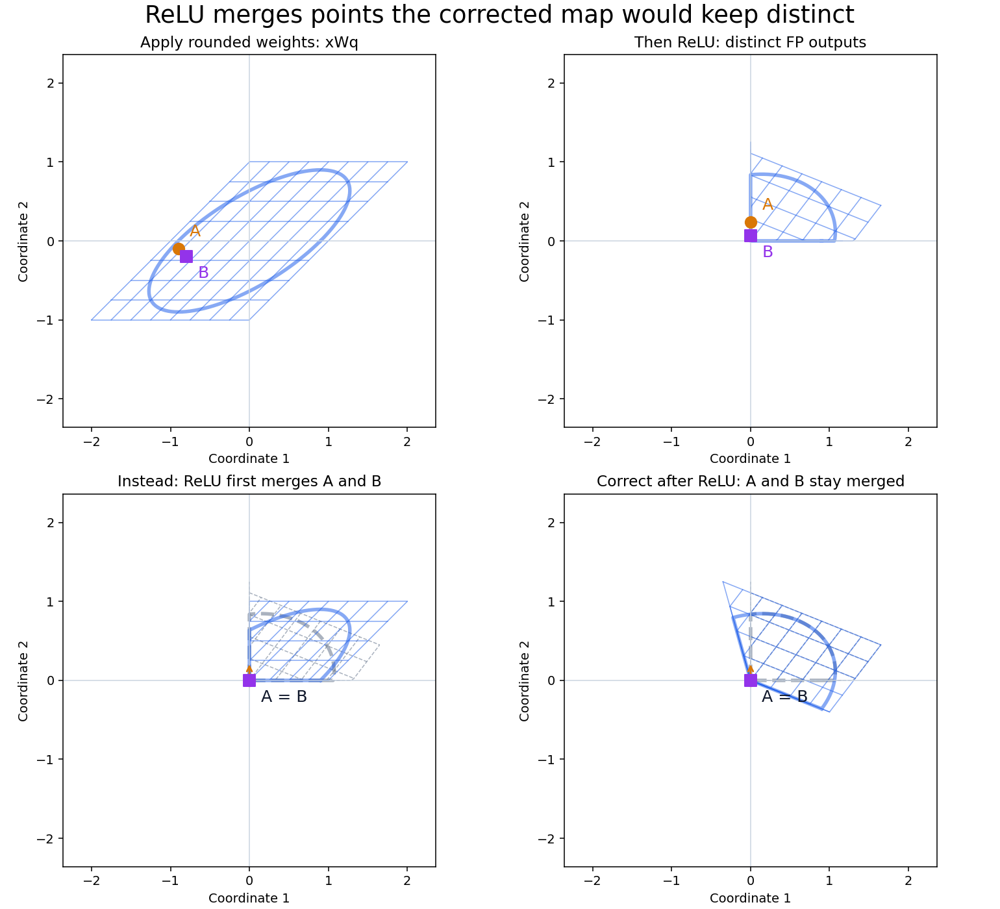
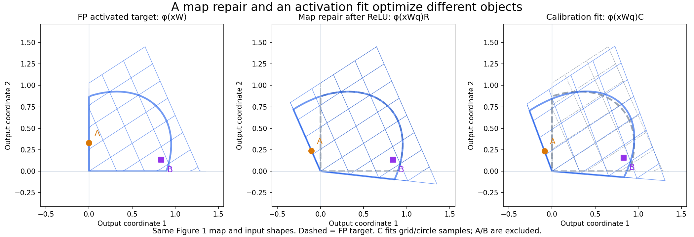
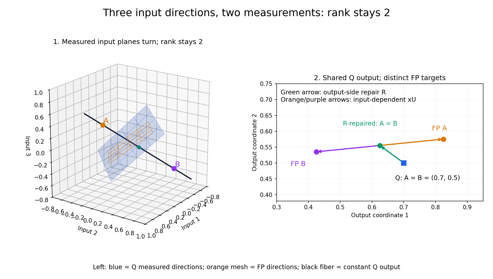

# Quantization geometry: deformation, repair, and an exact error ledger

Quantization changes the map of a layer. We follow the same points through that changed geometry, ask what an output-side transformation can repair, and examine what happens when activation intervenes. The ledger records the resulting signed displacements exactly; propagation experiments then ask what becomes of them downstream.

## 1. What shape does the layer move?

An input is a row vector $x\in\mathbb R^{1\times n}$, and the weights are $W,W_q\in\mathbb R^{n\times m}$. Start with the linear part of the layer: full precision (FP) sends x to xW; the quantized map (Q) sends the same x to xWq. The main argument uses zero bias; the float-bias extension comes later in [Technical details](#b3-exact-extension-to-a-shared-float-bias).

**Figure 1 — a changed map can be repaired.** The same grid, circle, and named samples move through each panel. FP and Q produce different shapes. Applying a full-precision map R to the Q shape recovers the FP target: the two right panels reach the same coordinates by different routes, $xW$ and $(xW_q)R$. Here Wq is square and invertible, with 2-bit coefficients; R is not quantized. No activation has yet intervened. Axes stay fixed, so the deformation is a change of map rather than a change of camera.

## 2. Which part can a map on the quantized output recover?

Start with the deformation in Figure 1. **Can a transformation acting on the quantized representation undo it?** R can mix and scale the output coordinates, moving the whole Q geometry back toward its FP target. **R is a full-precision correction, retained at the floating-point precision of W; it is not constrained to Wq's quantization grid.** Define the best linear map repair by

$$
R^\star\in\underset{R\in\mathbb R^{m\times m}}{\operatorname{argmin}}\;\|W-W_qR\|_F^2.
$$

This minimizes map discrepancy with input directions weighted equally. If $W_qR^\star=W$, the linear deformation is exactly repaired for every input. Write R for the selected optimizer; its explicit construction is a technical detail, not the reason for introducing it.

**Mathematically, when Wq is square and invertible, this repair is always exact before activation.** Its output still contains every input direction: we can undo the quantized map and apply the FP map instead,

$$
R=W_q^{-1}W,\qquad (xW_q)R=xW.
$$

Figure 1 shows this case. The exact-repair statement allows full-precision R; quantizing R would impose a further restriction on the repair.

Many ANN layers change width or map a convolutional patch to output channels, so their maps are rectangular. The square-invertible guarantee therefore cannot be assumed throughout a network. Widening maps can also retain every input direction; narrowing maps can leave out directions that FP uses, even when both maps have their maximum possible rank. The examples and general criterion are developed later in [Understanding the remainder U](#a-understanding-the-remainder-u) and [Technical details](#b2-rank-conditions-and-the-fiber-criterion-for-exact-repair).

### Repair the map, rather than fit selected responses

The repair objective compares the maps themselves, weighting input directions equally. Ordinary calibration instead fits FP responses for selected inputs, weighting directions according to the data. These objectives can favor different repairs when the map cannot be repaired exactly. The distinction is already present for linear maps; we will see a further difference once the layer applies an activation.

### Introduce ReLU: clipping changes the repair problem

The linear map produces a preactivation; the layer then applies ReLU. Geometrically, ReLU presses each negative coordinate onto zero: a shape can acquire edges on the axes, and distinct points can land together. Formally, $\phi(v)_j=\max(v_j,0)$. The two layer outputs are now

$$
z_q=xW_q,\qquad h=\phi(z_q),\qquad y=\phi(xW).
$$

First suppose R repairs the linear map exactly. Repairing before clipping gives the FP output. But a correction applied to the layer's output receives the already clipped shape. Moving a shape and then clipping it generally differs from clipping it and then moving it:

$$
\phi(z_q)R\ne\phi(z_qR).
$$

**Figure 2 — the order of repair and clipping matters.** This second map is exactly repairable before ReLU. Correcting first produces distinct positive FP outputs for A and B. Clipping the Q preactivations first merges both at zero; the same R then receives the same point for both. The obstruction arose after the linear map, even though that map's deformation was repairable.

Because repair is exact here, $y=\phi(z_qR)$. This gives a two-term account:

$$
h-y=\underbrace{h-hR}_{\text{repair left unapplied}}
+\underbrace{hR-\phi(z_qR)}_{\text{repair and activation do not commute}}.
$$

### Fitting the clipped outputs answers a different question

Now we can state the post-ReLU calibration objective. For a calibration sample set $\mathcal D$, fit a matrix to the activated Q and FP samples instead of reusing the map repair R:

$$
C_{\mathcal D}\in\underset{C}{\operatorname{argmin}}\;
\sum_{x\in\mathcal D}\|\phi(xW_q)C-\phi(xW)\|^2.
$$

R repairs the preactivation map; C fits the clipped responses on the chosen data. A post-ReLU fit can incorporate the effect of clipping and favor a different matrix even when R repairs the linear map exactly.

**Figure 3 — the map repair and the activation fit differ.** Return to the Figure 1 map, now with ReLU applied. The middle panel reuses R after activation; the right fits C to the displayed grid/circle samples. Both are compared with the same dashed FP target. C reduces activation error on those samples by choosing a different motion of the shape; it no longer exactly repairs the preactivation map. A/B were excluded from fitting.

We keep the geometric R fixed to examine how activation interferes with that repair. Choosing C to reduce calibration loss is a separate reconstruction problem. Both are least squares, but they supply different comparisons; this distinction is central to what the geometric ledger adds to PTQ correction.

### Some map deformation can remain before activation

The best allowed repair need not reproduce the FP map completely. Name the residual map deformation U:

$$
W=W_qR+U,\qquad xW=(xW_q)R+xU.
$$

R supplies a motion of the quantized representation; xU is the remaining input-dependent displacement needed to reach the FP map. In the square-invertible case above, U=0. This definition does not assume a particular rank-loss mechanism. With activation, its output effect is $\phi(z_qR)-\phi(z_qR+xU)$, rather than simply −xU. Adding this third comparison extends the two-term story into the exact ledger.

## 3. The ledger: four states, three signed displacements

For the same input x on both routes, define the four counterfactual states

| State | Definition | Geometric meaning |
|---|---|---|
| $s_0$ | $h=\phi(z_q)$ | Activated Q shape |
| $s_1$ | $hR$ | Apply the map repair after activation |
| $s_2$ | $\phi(z_qR)$ | Apply it before activation |
| $s_3$ | $\phi(z_qR+xU)=y$ | Restore the residual map displacement before activation |

These are comparisons, not four consecutive network layers. In particular s1 can have negative coordinates because R acts after ReLU. The local ledger records

$$
\mathcal L(x)=(e_{\rm uncomp},e_{\rm NL},e_{\rm range};e_{\rm total}),
\qquad e_{\rm total}=h-y.
$$

### Uncompensated deformation

$$
e_{\rm uncomp}=s_0-s_1=h-hR.
$$

This is the displacement left by not applying the available repair. Its negative is the correcting motion; this comparison alone does not say that correcting after activation would reach FP.

**Figure 4 — s1→s0, using the Figure 1 map.** The right panel overlays the repaired-after-activation shape and the uncorrected shape. Each arrow returns a named point from s1 to s0. The negative coordinates in s1 are legitimate counterfactual coordinates, not ReLU outputs.

### Nonlinearity-induced error

$$
e_{\rm NL}=s_1-s_2=hR-\phi(z_qR).
$$

This compares activation-then-repair with repair-then-activation, the two routes established in Figure 2. It measures failure of the chosen map repair to commute with activation.

**Figure 5 — s2→s1, using the Figure 2 map.** Correcting first gives A/B outputs (0,0.235) and (0,0.07). Correcting after clipping leaves both at zero. The two arrows show the exact nonlinear vectors (0,−0.235) and (0,−0.07).

### Range error: the activated effect of the remainder

$$
e_{\rm range}=s_2-s_3=\phi(z_qR)-\phi(z_qR+xU).
$$

This is the output difference caused by the residual map deformation after the available repair. ReLU can hide or expose its contribution. Specific reasons U can be nonzero are explored later, in [Understanding the remainder U](#a-understanding-the-remainder-u).

**Figure 6 — s3→s2.** In this example, the R-repaired route puts A/B together at (0.4,0.12), while FP activation separates them to (0.2,0) and (0.6,0.32). Their signed range vectors are (0.2,0.12) and (−0.2,−0.20). The preactivation cause is shown later in Figure A3; the definition above applies to any residual U.

### The accounting closes exactly

All three arrows point backwards along the same repair sequence. Consequently,

$$
e_{\rm uncomp}+e_{\rm NL}+e_{\rm range}
=(s_0-s_1)+(s_1-s_2)+(s_2-s_3)=s_0-s_3=h-y.
$$

The total is signed **Q minus FP**. Each component has a declared state comparison; it is not independently a Q-minus-FP error. The [bias extension](#b3-exact-extension-to-a-shared-float-bias) preserves this same identity for the implemented ledger.

## 4. Why component magnitudes cannot be added

The arrows can oppose one another. A repair that moves a point into a coordinate ReLU would remove can create two nonzero ledger components whose displacements cancel.

**Figure 7 — the ledger can double back.** The range arrow reaches s2; the nonlinear arrow moves down to s1; the uncompensated arrow comes back to s0=s2. The last two vectors cancel, leaving total error equal to the range vector at this sample. This is sample-dependent, not a universal cancellation. Component magnitudes therefore cannot be reported as additive percentages of total error. The formal interaction and Gram accounting are in [Technical details](#b5-signed-interaction-and-the-gram-identity).

## 5. Creation here versus propagation through the network

A local ledger uses the same input on both routes. In a network, the quantized run may arrive with input a while FP arrives with a_fp. Keeping the same zero-bias convention, let $h_q=\phi(aW_q)$ and $h_{\rm fp}=\phi(a_{\rm fp}W)$ and define

$$
e_{\rm local}=\phi(aW_q)-\phi(aW),\qquad
 e_{\rm propagated}=\phi(aW)-h_{\rm fp}.
$$

Then raw total error is their sum. The first term measures the layer's own map change on the arriving point. The second measures where the upstream-displaced point lands under the unchanged FP layer. The three-component ledger decomposes the first term; it does not yet trace each component separately through later nonlinear layers.

An exact residual oracle adds $h_{\rm fp}-h_q$ at a chosen output. Geometrically, it moves each damaged point back to its FP location before the next layer consumes it. Immediate resets isolate local creation by giving each following layer the FP input. A delayed reset restores the accumulated discrepancy at that later layer; it is source-specific only when the named source is the sole perturbation. Following named points through those alternative trajectories is the next geometric experiment.

The [implementation README](quant_geometry_implementation.md) describes the runner and oracle interfaces. The [verification report](quant_geometry_verification.md) records tests, diagnostic figures, numerical results, and contributions. The [progress tracker](quant_geometry_progress.md) records the remaining experiments.

## A. Understanding the remainder U

These examples explain how a residual can arise once the main repair/activation/ledger argument is established. Neither a scalar neuron nor rank collapse is the generic premise of the decomposition.

### A.1 A single measurement: gain, direction, and fibers

For a view of individual measurement directions, take one neuron with no bias or activation. In this picture, write the input point x and weight vector w as **column vectors** in two dimensions. The neuron returns the scalar $x^\top w$. Its weight arrow tells us both **which input direction it measures** and **the gain of that measurement**.

Quantization changes w into wq. Generally, the arrow changes length and turns: the neuron now measures a different input direction with a different gain. Assume $w_q\ne0$. Suppose we keep only its quantized scalar output and try to repair it by multiplying by a scalar r. Can that put every input's response back where it should be?

Changing r stretches or reverses the arrow wq along its own line. It cannot turn it toward w. Consequently, exact repair for every input is possible precisely when w lies on that line:

$$
r\,x^\top w_q=x^\top w\quad\text{for every }x
\quad\Longleftrightarrow\quad w=r w_q.
$$

A parallel weight change can be repaired by changing gain. A change of direction leaves a part of the FP measurement outside the direction that this scalar correction can access.

**Figure A1 — a direction changes without a rank collapse.** On the left, the FP arrow w and the quantized arrow wq differ in length and direction. The green arrow rwq is the projection of w onto the line of wq: scalar gain can reach it. The purple arrow u supplies the remaining change of direction. On the right, each line is a **fiber**: all inputs on it give the same scalar response. A and B lie on one blue Q fiber but on different orange FP fibers. Any correction receiving just their shared Q reading must return the same answer for both, although FP requires different answers.

Here the bounded 2-bit quantizer changes $w=(1,0.55)^\top$ to $w_q=(1,1)^\top$. Both measurements have rank 1, as a nonzero scalar measurement in 2D must. **Quantization has rotated the fibers, not reduced the rank.** The distinction FP wants is now along a direction Q ignores.

#### Recover the accessible part; name the part that remains

The closest arrow to w on the line of wq is its orthogonal projection. Call its scalar gain r and the remaining arrow u:

$$
r=\frac{w_q^\top w}{w_q^\top w_q},\qquad
w=r w_q+u,\qquad w_q^\top u=0.
$$

This is the least-squares repair of the weight direction: r minimizes $\|w-tw_q\|^2$ over scalar gains t. For each input, the same split becomes

$$
x^\top w=r\,(x^\top w_q)+x^\top u.
$$

The first term can be generated from the Q scalar alone. The second measures the input component along u, perpendicular to the direction Q measures. That is exactly the distinction lost when we keep only $x^\top w_q$.

A fiber has the formal definition $F_q(c)=\{x:x^\top w_q=c\}$. In the plane, it is a line perpendicular to wq. Multiplying the scalar by r changes the values assigned to these fibers; it cannot change which inputs share a fiber. If $u\ne0$, moving along u stays on a Q fiber but changes the FP reading, because $u^\top w_q=0$ while $u^\top w=\|u\|^2>0$. This proves that no function of the Q scalar alone can recover every FP response in this case.

For the highlighted points, $A=(0.8,-0.2)^\top$ and $B=(-0.2,0.8)^\top$:

$$
A^\top w_q=B^\top w_q=0.6,\qquad
A^\top w=0.69,\qquad B^\top w=0.24.
$$

The projection gives $r=0.775$ and $u=(0.225,-0.225)^\top$. The output-side repair therefore gives 0.465 for **both** points. To reach FP, A still needs +0.225 while B needs −0.225. Their shared Q scalar contains no way to choose between those two input-dependent additions.

### A.2 Rectangular measurements and CNN patch channels

A layer can deliberately make fewer measurements than it receives coordinates. For a $3\times3$ convolution with 64 input and 64 output channels, one output location measures a patch with $64\cdot3\cdot3=576$ coordinates and returns 64 values. In row-vector form that patch map is $576\times64$, not an invertible square matrix. Its dimensions follow directly from the [standard convolution weight shape](https://docs.pytorch.org/docs/stable/generated/torch.nn.Conv2d.html).

An output-side correction that mixes channels **at that location** sees only those 64 measurements. It can mix and rescale them, but cannot choose independently among patches that produce the same values. A correction that also mixes neighbouring output locations has a larger repair channel; here we are examining the patch-to-channel map.

Importantly, a rectangular map can have its **maximum possible rank** and still ignore input directions. If $m<n$, even rank m leaves $n-m$ directions unmeasured. The FP and Q maps can both retain rank m while their measured input subspaces turn relative to each other. Then Q ignores an input distinction that FP uses—the same phenomenon as the scalar example, with several measurements.

**Figure A2 — architectural dimension reduction without a rank drop.** Both maps take three input coordinates to two measurements, and both have rank 2. In the left panel, the blue plane and orange mesh show Q and FP measured directions. Their orientations differ. Moving along the black Q fiber leaves both Q measurements unchanged. A and B sit on that fiber. On the right, they share the Q point and the R-repaired point, but need different FP targets. The green arrow is the available output-side repair; the orange and purple arrows supply the different xU contributions. Everything is before activation.

The example uses bounded 2-bit quantization:

$$
W=\begin{bmatrix}1&0.25\\0.75&1\\0.25&0.8\end{bmatrix},\qquad
W_q=\begin{bmatrix}1&0\\1&1\\0&1\end{bmatrix}.
$$

The Q fiber direction is $d=(1,-1,1)$, with $dW_q=(0,0)$ but $dW=(0.5,0.05)$. For A=(0.7,0,0.5) and B=(−0.1,0.8,−0.3),

$$
AW_q=BW_q=(0.7,0.5),\qquad
AW=(0.825,0.575),\qquad BW=(0.425,0.535).
$$

R moves their shared representation to (0.625,0.555). The missing xU contributions are (+0.2,+0.02) and (−0.2,−0.02). Wq's two nonzero singular values are $\sqrt3$ and 1; no small direction was truncated. The dimension reduction is built into the **3→2 architecture**, while quantization changes which input distinctions its two measurements retain.

### A.3 Exact rank collapse: a particularly visible limiting case

A rotated scalar measurement already showed nonrecoverability without a rank change. An outright rank drop makes the missing distinction particularly easy to see: an entire patch flattens into a line.

**Figure A3 — a limiting case with genuine dimension collapse.** Panel 1 shows distinct FP targets for A and B. Quantization merges them in panel 2. R moves their shared output to the best common target in panel 3, but cannot separate them or restore the patch's width. Panel 4 supplies different xU displacements from the original inputs and recovers the FP patch. The dashed line is the R-repaired state; the arrows are xU. All panels are before activation.

The matrices are

$$
W=\begin{bmatrix}1&0.3\\0.25&0.25\end{bmatrix},\qquad
W_q=\begin{bmatrix}1&0\\0&0\end{bmatrix},\qquad
R=\begin{bmatrix}1&0.3\\0&1\end{bmatrix},\qquad
U=\begin{bmatrix}0&0\\0.25&0.25\end{bmatrix}.
$$

A=(0.4,−0.8) and B=(0.4,0.8) share the Q point (0.4,0). Their FP targets are (0.2,−0.08) and (0.6,0.32). R moves both to the midpoint (0.4,0.12); xU then contributes (−0.2,−0.2) for A and (+0.2,+0.2) for B. The second input direction has disappeared outright. This illustrates an extreme case, rather than an assumption that quantization usually reduces rank. Figure 6 measures the effect after activation.

## B. Technical details

### B.1 Constructing the chosen repair

The map objective is $\min_R\|W-W_qR\|_F^2$. To select the optimizer closest to the unchanged output map, write $R=I_m+C$ and choose the minimum-norm least-squares increment:

$$
\min_C\|W-W_q-W_qC\|_F^2,\qquad C=W_q^\dagger(W-W_q).
$$

For the exact Moore–Penrose inverse,

$$
R=I_m+W_q^\dagger(W-W_q),\qquad
U=(I_n-W_qW_q^\dagger)(W-W_q).
$$

Here R is m×m and U is n×m. With $P=W_qW_q^\dagger$, $W_qR=PW$ and $U=(I_n-P)W$. P projects onto the input-direction span measured by Wq, and $W_q^\top U=0$. This orthogonality is between measurement directions/maps; it does not make their output displacements perpendicular for every sample.

The optimum repaired map WqR is unique. R's extension away from the represented output subspace need not be unique; the identity-centered construction fixes that extension. The geometric objective is also proportional to the mean squared preactivation error for inputs uniform on the unit sphere. Empirical preactivation reconstruction instead weights directions by the data second moment; the objectives coincide under suitable isotropic sampling.

### B.2 Rank conditions and the fiber criterion for exact repair

Section 2 establishes exact repair for square invertible Wq. A square inverse is sufficient, but not necessary. A rectangular map with $m\ge n$ can also preserve all n input directions. If Wq has full row rank, $W_qW_q^\dagger=I_n$, so x can still be recovered from xWq and U=0. The dividing line is **which input directions are retained**, rather than whether the matrix happens to be square.

For arbitrary inputs and the exact pseudoinverse, the general criterion is

$$
U=0\quad\Longleftrightarrow\quad
\operatorname{col}(W)\subseteq\operatorname{col}(W_q)
\quad\Longleftrightarrow\quad
\ker(W_q^\top)\subseteq\ker(W^\top).
$$

The first equivalence follows from $U=(I_n-P)W$; the second takes orthogonal complements. Inputs A and B share a Q preactivation exactly when their difference d satisfies dWq=0. The kernel condition says every such difference must also satisfy dW=0: FP must be constant on each Q fiber.

Conversely, if U has a nonzero column u, take $d=u^\top$. Orthogonality gives dWq=0, while dW=dU has the positive entry $u^\top u$ in that column. Thus A and A+d share the same Q representation but have different FP preactivations. No function of the Q representation alone can recover both for an unrestricted input domain. Figures A1–A3 show this criterion with named points; it makes no assumption that quantization has reduced rank. An activated target or a restricted data domain poses a different recovery question.

### B.3 Exact extension to a shared float bias

The figures use b=0. With a shared float bias $b\in\mathbb R^{1\times m}$, moving $z_q=xW_q+b$ by R would also move the bias. Restore it by translating the result back by $b-bR$:

$$
A(v)=vR+b-bR,\qquad A(z_q)+xU=x(W_qR+U)+b=xW+b.
$$

A is the bias-preserving version of the same repair. The implemented ledger uses A so the geometry and accounting remain consistent with float biases.

For shared float bias, the exact states are

$$
z_q=xW_q+b,\quad s_0=\phi(z_q),\quad s_1=A(s_0),\quad
s_2=\phi(A(z_q)),\quad s_3=\phi(A(z_q)+xU).
$$

The same signed definitions $e_{\rm uncomp}=s_0-s_1$, $e_{\rm NL}=s_1-s_2$ and $e_{\rm range}=s_2-s_3$ telescope to Q minus FP. If activation is the identity, the nonlinear component vanishes even with bias.

For the propagation comparison in Section 5, include the shared b inside each preactivation: the arriving Q output, same-input FP output, and reference FP output. Their successive differences still give local and propagated error, and the oracle still adds reference FP minus arriving Q.

### B.4 Correction extensions and attribution

The ledger is an exact accounting convention relative to the chosen R and rank policy, rather than a unique partition into physical causes. With the exact pseudoinverse, replacing R by R+N with $W_qN=0$ preserves the linear reconstruction with the same U. But the bias-preserving affine transport becomes $A'(v)=A(v)+(v-b)N$. Activation can move $h-b$ outside the row space of Wq, so uncompensated and nonlinear components can change while their sum and the total remain unchanged. We fix the identity-centered R above whenever comparing component values.

### B.5 Signed interaction and the Gram identity

Take the zero-bias map
$W=\left[\begin{smallmatrix}1&-0.35\\0.28&0.22\end{smallmatrix}\right]$,
$W_q=\operatorname{diag}(1,0)$, and x=(1,2). The four states are

$$
s_0=(1,0),\quad s_1=(1,-0.35),\quad s_2=(1,0),\quad s_3=(1.56,0.09).
$$

In Figure 7, starting at FP (s3), the range arrow reaches s2. The nonlinear arrow goes down to s1; the uncompensated arrow comes straight back to s0=s2. Their vertical displacements cancel:

$$
e_{\rm uncomp}=(0,0.35),\qquad e_{\rm NL}=(0,-0.35),\qquad
 e_{\rm range}=e_{\rm total}=(-0.56,-0.09).
$$

This cancellation is sample-dependent. For this same map, writing $x=(s,t)$ and $s_+=\max(s,0)$ gives
$e_{\rm uncomp}=(0,0.35s_+)$ and $e_{\rm NL}=(0,-0.35|s|)$; they cancel for s≥0 but not s<0.

For a dataset $\{x_k\}_{k=1}^N$, define the interaction ledger

$$
G_{ij}=\frac1N\sum_k\langle e_i(x_k),e_j(x_k)\rangle,
\qquad i,j\in\{\mathrm{uncomp},\mathrm{NL},\mathrm{range}\}.
$$

The inner product measures alignment: same-direction arrows reinforce, opposing arrows cancel, perpendicular arrows have zero cross term. Therefore

$$
\frac1N\sum_k\|e_{\rm total}(x_k)\|^2
=\sum_iG_{ii}+2\sum_{i<j}G_{ij}.
$$

G is an uncentered second-moment Gram matrix. Its diagonal entries are individual mean squared magnitudes; its off-diagonal entries record interaction. Figure 7 supplies the intuitive picture for a negative cross term. Individual energies are not additive percentages of total error.

### B.6 Matrices for the main geometric examples

Figure 1 uses

$$
W=\begin{bmatrix}1&0.65\\-0.35&0.8\end{bmatrix},\qquad
W_q=\begin{bmatrix}1&1\\0&1\end{bmatrix},\qquad
R=\begin{bmatrix}1.35&-0.15\\-0.35&0.8\end{bmatrix},\qquad U=0.
$$

Bounded symmetric 2-bit quantization rounds the coefficients to {−1,0,1}. Figure 3 uses this same map, fitting its post-ReLU C on the sampled grid/circle points with the named A/B probes excluded. The coefficient matrix and calibration definition are recorded in [the comparison fixture](figures/quant_geometry/repair_vs_reconstruction_fixture.json).

Figures 2 and 5 use

$$
W=\begin{bmatrix}1&-0.4\\0.65&0.85\end{bmatrix},\qquad
W_q=\begin{bmatrix}1&0\\1&1\end{bmatrix},\qquad
R=\begin{bmatrix}1&-0.4\\-0.35&1.25\end{bmatrix},\qquad U=0.
$$

A=(−0.8,−0.1) and B=(−0.6,−0.2) become Q preactivations (−0.9,−0.1) and (−0.8,−0.2). Correcting first gives the positive FP responses shown in Figure 5; Q's ReLU instead merges both at zero. This particular collision proves no decoder of h alone can recover both FP targets. A nonzero nonlinear component in general establishes only noncommutation of the declared repair and activation.

Numerical note: an exact missing direction versus a deliberately truncated one

The conceptual repair problem above uses the exact Moore–Penrose inverse. If the implementation truncates small singular values, write its inverse $W_{q,\tau}^\dagger$ and use that inverse in the formulas for R and U. The resulting R need not minimize the untruncated repair objective. Reconstruction still holds, but

$$
P_\tau=W_qW_{q,\tau}^\dagger,\qquad
U_\tau=(I_n-P_\tau)(W-W_q).
$$

Only retained-space orthogonality is guaranteed; this remainder need not equal $(I_n-P_\tau)W$. A tiny **nonzero** direction remains present in xWq, and recovering it may require a large gain. A nonzero truncated remainder measures what this correction policy leaves unrecovered; it does not alone establish lost information. Figure A3 has an exact zero direction. A restricted input distribution or activation can also hide the output effect of an exact missing direction.

See the [implementation README](quant_geometry_implementation.md#quantizer-and-decomposition) for cutoff settings and the [verification report](quant_geometry_verification.md#mathematical-audit-numerical-rank-and-attribution-conventions) for the numerical counterexample.

