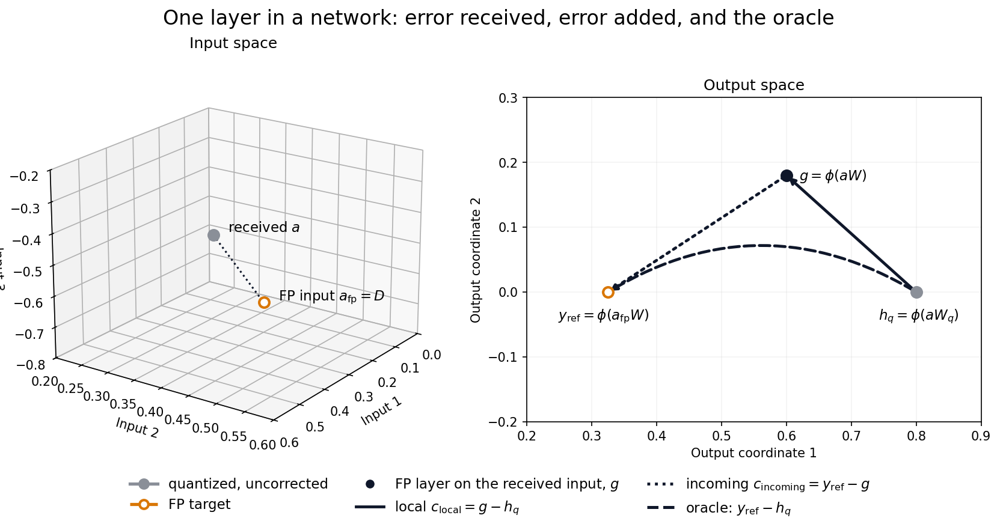

# Quantization geometry: deformation, repair, and an exact ledger

Weight quantization changes the linear map of a layer. We follow the same points through that changed geometry, ask what an output-side transformation can repair, and examine what happens when activation intervenes. The ledger starts with the correction owed to FP, applies the available repair, and explains its remaining balance. Network experiments then follow that balance downstream.

## 1. What shape does the layer move?

An input is a row vector $x\in\mathbb R^{1\times n}$, and the weights are $W,W_q\in\mathbb R^{n\times m}$. Start with the linear part of the layer: full precision (FP) sends x to xW; the quantized map Q sends the same x to xWq. The main argument uses zero bias; the float-bias extension comes later in [Technical details](#b3-float-bias-and-the-implementation-sign-convention).

**Figure 1 — a changed map can be repaired.** The same grid, circle, and named samples move through each panel. FP and Q produce different shapes. Applying a full-precision map R to the Q shape recovers the FP target: the two right panels reach the same coordinates by different routes, $xW$ and $(xW_q)R$. Here Wq is square and invertible, with 2-bit coefficients; R is not quantized. No activation has yet intervened. Axes stay fixed, so the deformation is a change of map rather than a change of camera.

## 2. Which part can a map on the quantized output recover?

Start with the deformation in Figure 1. **Can a transformation acting on the quantized representation undo it?** R can mix and scale the output coordinates, moving the whole Q geometry back toward its FP target. **R is a full-precision correction, retained at the floating-point precision of W; it is not constrained to Wq's quantization grid.** Define the best linear map repair by

$$
R_{\rm map}\in\underset{R\in\mathbb R^{m\times m}}{\operatorname{argmin}}\;\|W-W_qR\|_F^2.
$$

This minimizes map discrepancy with input directions weighted equally. If $W_qR_{\rm map}=W$, the linear deformation is exactly repaired for every input. $R=R_{\rm map}$ is a distinct component from the data-conditioned fits below.

**When Wq is square and invertible, this repair is always exact before activation.** Its output still contains every input direction: we can undo the quantized map and apply the FP map instead (Fig. 1, requires **full-precision** R):

$$
R=W_q^{-1}W,\qquad (xW_q)R=xW.
$$

Many ANN layers change width or map a convolutional patch to output channels, so their maps are rectangular. The square-invertible guarantee therefore cannot be assumed throughout a network. Widening maps can also retain every input direction; narrowing maps can leave out directions that FP uses, even when both maps have their maximum possible rank. The examples and general criterion are developed later in [Understanding the remainder U](#a-understanding-the-remainder-u) and [Technical details](#b2-rank-conditions-and-the-fiber-criterion-for-exact-repair).

### Repair the map, rather than fit selected responses

The map objective gives every input direction equal weight. A calibration set $\mathcal D$ instead supplies a cloud of inputs: fitting their FP responses gives more weight to the directions and correlations that occur in that cloud. Before introducing activation, this gives a second objective,

$$
R_{\rm pre,data}\in\underset{R\in\mathbb R^{m\times m}}{\operatorname{argmin}}\;
\sum_{x\in\mathcal D}\|xW_qR-xW\|^2.
$$

The transformation being fitted is still linear. What changed is **where we ask it to be accurate**. The data fit prioritizes matching FP responses for the inputs that occur in the calibration set, even if this costs larger map error elsewhere. Figure 3's top row shows the consequence directly: the two fits move the same Q points differently.

The two optimizers can coincide—for example, with isotropic input weighting, or when an exact repair is identified by the calibration samples. Figure 3 uses a full-rank rectangular map so the distribution's effect is visible. No activation is involved in this first change of objective.

### Introduce ReLU: clipping changes the repair problem

The linear map produces a preactivation; the layer then applies ReLU. Geometrically, ReLU presses each negative coordinate onto zero: a shape can acquire edges on the axes, and distinct points can land together. Formally, $\phi(v)_j=\max(v_j,0)$. The two layer outputs are now

$$
z_q=xW_q,\qquad h=\phi(z_q),\qquad y=\phi(xW).
$$

First suppose R repairs the linear map exactly. Repairing before clipping gives the FP output. But a correction applied to the layer's output receives the already clipped shape. Moving a shape and then clipping it generally differs from clipping it and then moving it:

$$
\phi(z_q)R\ne\phi(z_qR).
$$

**Figure 2 — the order of repair and clipping matters.** Continue Figure 1 with the same W, Wq, R, grid, circle, and A/B inputs; now introduce ReLU. Correcting first produces distinct positive FP outputs for A and B. Clipping the Q preactivations first merges both at zero; the same R then receives the same point for both. The obstruction arose after the linear map, even though that map's deformation was repairable.

Here $y=\phi(z_qR)$, but applying R after ReLU need not reach y. We will account for that remaining gap in the ledger.

### Fitting the clipped outputs answers a different question

Keep the same calibration set and the same full-precision linear correction family. Now fit the activated Q and FP responses:

$$
R_{\rm post,data}\in\underset{R\in\mathbb R^{m\times m}}{\operatorname{argmin}}\;
\sum_{x\in\mathcal D}\|\phi(xW_q)R-\phi(xW)\|^2.
$$

This changes **what information the fit can use and what target it matches**. ReLU removes negative coordinates and changes the correlations between the available representation and the FP response. The preferred matrix can therefore change again, even with the same inputs and correction capacity.

| Repair | Objective to minimize | Weighting / available information |
|---|---|---|
| $R_{\rm map}$ | $\lVert W-W_qR\rVert_F^2$ | Input directions weighted equally |
| $R_{\rm pre,data}$ | $\sum_{x\in\mathcal D}\lVert xW_qR-xW\rVert^2$ | Input distribution and its linear correlations |
| $R_{\rm post,data}$ | $\sum_{x\in\mathcal D}\lVert\phi(xW_q)R-\phi(xW)\rVert^2$ | The clipped representation and its remaining correlations |

**Figure 3 — map geometry → data-conditioned map reconstruction → data-conditioned activation reconstruction.** The four columns show Q without correction and the three fitted matrices. The top row applies each matrix to the Q preactivation; the bottom row applies it to the already clipped Q output. Dashed gray is the corresponding FP target for the same inputs. Each correction column uses the same matrix in both rows; there is no further ReLU after correction.

The grid and circle show a representative subset of inputs; the fits and reported errors use the full calibration set. The map fit has the smallest weight-map error. The preactivation data fit matches FP on the displayed subset exactly, so its blue shape covers the dashed target in the top row; error on the additional calibration inputs keeps its reported MSE nonzero. Applying that same matrix after clipping misses the activated target. The post-ReLU fit changes the motion again and has the lowest activation error on the full calibration set. A/B were excluded from all fits. Both FP and Q maps retain rank 2 throughout this comparison.

**All three are least squares, but they answer different questions.** The geometric ledger fixes $R=R_{\rm map}$ to examine the changed map and activation's interference with its repair. The other two fits ask how well a correction reconstructs responses under a particular data distribution. Their losses alone do not supply that geometric accounting.

### When the linear map repair is incomplete

Figures 1 and 2 used exactly repairable maps to isolate the obstruction introduced by ReLU. Figure 3 returns to the general repair problem: even the best map repair can leave a gap to FP before activation. The activated R-repaired shape can therefore differ from FP for a second reason, beyond the ordering of repair and ReLU.

Before activation, the gap between the R-repaired point and its FP target is xU. Define the residual map U by

$$
U=W-W_qR,\qquad W=W_qR+U,\qquad xW=(xW_q)R+xU.
$$

R supplies the selected output-side motion of the Q geometry; xU completes the motion to FP using the original input. In the square-invertible case, U=0. Evaluating xU uses the original input: it is an analysis step, not another operation in the output-side repair channel.

After ReLU, the FP target is $y=\phi(z_qR+xU)$. We now have both limits of the output-side repair: activation can obstruct it, and the linear map repair can itself be incomplete. The ledger starts with the observed gap to FP, applies R, and uses these two comparisons to explain what remains.

## 3. The ledger: what correction is still owed?

For input x, the layer produced h; FP would produce y. The correction owed is:

$$
c_{\rm total}=y-h.
$$

This vector points from Q to FP. Now try the available map repair.

### Apply R and inspect the balance

R moves the point from h to hR, supplying

$$
c_R=hR-h,\qquad c_{\rm total}=c_R+(y-hR).
$$

**The balance after R is y−hR.** Explain it by inspecting the two limits of the repair.

**Figure 4 — correction owed → R applied → balance remaining.** The same map and inputs from Figures 1–2, now viewed as a repair account. R moves the clipped shape, but the marked A/B both start at zero and stay there: their full correction is still owed. R acts after ReLU, so other points in hR can have negative coordinates.

### Exact linear repair: the remaining balance comes from activation ordering

With U=0, repair before ReLU reaches FP: $y=\phi(z_qR)$. The balance after applying R to the clipped output is

$$
c_{\rm NL}=\phi(z_qR)-hR=y-hR,\qquad
c_{\rm total}=c_R+c_{\rm NL}\quad(U=0).
$$

First use the map repair; then account for the gap left because activation came first.

**Figure 5 — hR→φ(zqR)=y.** Account for Figure 4's remaining balance using the repair-before-clipping route already shown in Figure 2. Clipping first leaves A/B together at zero. The arrows reconcile this with their distinct FP targets, (0,0.235) and (0,0.07). The linear repair was exact; activation obstructed it.

### Incomplete linear repair: reconcile the rest of the balance

Incomplete map repair can leave a further gap from $\phi(z_qR)$ to FP—the activated effect of U:

$$
c_U=y-\phi(z_qR)=\phi(z_qR+xU)-\phi(z_qR).
$$

Thus the balance after R has two parts:

$$
y-hR=
\underbrace{\phi(z_qR)-hR}_{c_{\rm NL}:\ \text{activation obstructed the repair}}
+\underbrace{y-\phi(z_qR)}_{c_U:\ \text{linear map repair was incomplete}}.
$$

**Figure 6 — φ(zqR)→y.** The repaired route puts A/B together at (0.4,0.12). Their FP targets differ, requiring balances (−0.2,−0.12) and (+0.2,+0.20).

The account closes:

$$
\boxed{c_{\rm total}=c_R+c_{\rm NL}+c_U.}
$$

**$c_R$ is the available repair; $c_{\rm NL}$ and $c_U$ explain its outstanding balance.** The ledger records these contributions against the total owed, following

$$
h\ \longrightarrow\ hR\ \longrightarrow\ \phi(z_qR)\ \longrightarrow\ y.
$$

Only the first arrow uses h and R alone; the two explanatory comparisons use zq and the FP target, respectively. Bias and implementation signs are handled in [Technical Details](#b3-float-bias-and-the-implementation-sign-convention).

## 4. Repair contributions can cancel

Contributions are vectors: a repair motion can be undone by a later balance. Their norms are therefore not additive percentages of the total correction needed.

**Figure 7 — a repair can be partly undone.** R moves down, the activation-order balance returns, and the residual-deformation balance reaches FP. Here $c_{\rm total}=c_U$. The Gram identity is in [Technical Details](#b5-signed-interaction-and-the-gram-identity).

## 5. From one layer to a network: incoming and local balances

In a network, the arriving input a can already differ from the reference a_fp. Compare the actual Q output $h_q=\phi(aW_q)$ with same-input FP $g=\phi(aW)$, then reference FP $y_{\rm ref}=\phi(a_{\rm fp}W)$. This separates what the layer changed from what arrived upstream.

They reconcile the outstanding output balance:

$$
y_{\rm ref}-h_q=
\underbrace{g-h_q}_{c_{\rm local}}+
\underbrace{y_{\rm ref}-g}_{c_{\rm incoming}}.
$$

Section 3 reconciles the local balance on the arriving input. The incoming balance measures where the earlier displacement lands under this FP map.

**Figure 8 — incoming versus newly created discrepancy.** Right: local hq→g, then incoming g→reference FP. The oracle resets the whole balance directly.

### The oracle resets the outstanding balance

Adding $y_{\rm ref}-h_q$ resets the balance before the next layer. Immediate resets give each following layer the FP input, isolating local creation. A delayed reset restores the accumulated discrepancy at its output; it isolates a named source only if that source was the sole perturbation.

Recording each operation's change and updating the balance lets us follow alternative network trajectories.

[Implementation](quant_geometry_implementation.md), [verification](quant_geometry_verification.md), and [next experiments](quant_geometry_progress.md) are documented separately.

## A. Understanding the remainder U

These examples explain how a residual can arise once the main repair/activation/ledger argument is established. Neither a scalar neuron nor rank collapse is the generic premise of the decomposition.

### A.1 A single measurement: gain, direction, and fibers

For a view of individual measurement directions, take one neuron with no bias or activation. In this picture, write the input point x and weight vector w as **column vectors** in two dimensions. The neuron returns the scalar $x^\top w$. Its weight arrow tells us both **which input direction it measures** and **the gain of that measurement**.

Quantization changes w into wq. Generally, the arrow changes length and turns: the neuron now measures a different input direction with a different gain. Assume $w_q\ne0$. Suppose we keep only its quantized scalar output and try to repair it by multiplying by a scalar r. Can that put every input's response back where it should be?

Changing r stretches or reverses the arrow wq along its own line. It cannot turn it toward w. Consequently, exact repair for every input is possible precisely when w lies on that line:

$$
r\,x^\top w_q=x^\top w\quad\text{for every }x
\quad\Longleftrightarrow\quad w=r w_q.
$$

A parallel weight change can be repaired by changing gain. A change of direction leaves a part of the FP measurement outside the direction that this scalar correction can access.

**Figure A1 — a direction changes without a rank collapse.** On the left, the FP arrow w and the quantized arrow wq differ in length and direction. The green arrow rwq is the projection of w onto the line of wq: scalar gain can reach it. The purple arrow u supplies the remaining change of direction. On the right, each line is a **fiber**: all inputs on it give the same scalar response. A and B lie on one blue Q fiber but on different orange FP fibers. Any correction receiving just their shared Q reading must return the same answer for both, although FP requires different answers.

Here the bounded 2-bit quantizer changes $w=(1,0.55)^\top$ to $w_q=(1,1)^\top$. Both measurements have rank 1, as a nonzero scalar measurement in 2D must. **Quantization has rotated the fibers, not reduced the rank.** The distinction FP wants is now along a direction Q ignores.

#### Recover the accessible part; name the part that remains

The closest arrow to w on the line of wq is its orthogonal projection. Call its scalar gain r and the remaining arrow u:

$$
r=\frac{w_q^\top w}{w_q^\top w_q},\qquad
w=r w_q+u,\qquad w_q^\top u=0.
$$

This is the least-squares repair of the weight direction: r minimizes $\|w-tw_q\|^2$ over scalar gains t. For each input, the same split becomes

$$
x^\top w=r\,(x^\top w_q)+x^\top u.
$$

The first term can be generated from the Q scalar alone. The second measures the input component along u, perpendicular to the direction Q measures. That is exactly the distinction lost when we keep only $x^\top w_q$.

A fiber has the formal definition $F_q(c)=\{x:x^\top w_q=c\}$. In the plane, it is a line perpendicular to wq. Multiplying the scalar by r changes the values assigned to these fibers; it cannot change which inputs share a fiber. If $u\ne0$, moving along u stays on a Q fiber but changes the FP reading, because $u^\top w_q=0$ while $u^\top w=\|u\|^2>0$. This proves that no function of the Q scalar alone can recover every FP response in this case.

For the highlighted points, $A=(0.8,-0.2)^\top$ and $B=(-0.2,0.8)^\top$:

$$
A^\top w_q=B^\top w_q=0.6,\qquad
A^\top w=0.69,\qquad B^\top w=0.24.
$$

The projection gives $r=0.775$ and $u=(0.225,-0.225)^\top$. The output-side repair therefore gives 0.465 for **both** points. To reach FP, A still needs +0.225 while B needs −0.225. Their shared Q scalar contains no way to choose between those two input-dependent additions.

### A.2 Rectangular measurements and CNN patch channels

A layer can deliberately make fewer measurements than it receives coordinates. For a $3\times3$ convolution with 64 input and 64 output channels, one output location measures a patch with $64\cdot3\cdot3=576$ coordinates and returns 64 values. In row-vector form that patch map is $576\times64$, not an invertible square matrix. Its dimensions follow directly from the [standard convolution weight shape](https://docs.pytorch.org/docs/stable/generated/torch.nn.Conv2d.html).

An output-side correction that mixes channels **at that location** sees only those 64 measurements. It can mix and rescale them, but cannot choose independently among patches that produce the same values. A correction that also mixes neighbouring output locations has a larger repair channel; here we are examining the patch-to-channel map.

Importantly, a rectangular map can have its **maximum possible rank** and still ignore input directions. If $m<n$, even rank m leaves $n-m$ directions unmeasured. The FP and Q maps can both retain rank m while their measured input subspaces turn relative to each other. Then Q ignores an input distinction that FP uses—the same phenomenon as the scalar example, with several measurements.

**Figure A2 — architectural dimension reduction without a rank drop.** Both maps take three input coordinates to two measurements, and both have rank 2. In the left panel, the blue plane and orange mesh show Q and FP measured directions. Their orientations differ. Moving along the black Q fiber leaves both Q measurements unchanged. A and B sit on that fiber. On the right, they share the Q point and the R-repaired point, but need different FP targets. The green arrow is the available output-side repair; the orange and purple arrows supply the different xU contributions. Everything is before activation.

The example uses bounded 2-bit quantization:

$$
W=\begin{bmatrix}1&0.25\\0.75&1\\0.25&0.8\end{bmatrix},\qquad
W_q=\begin{bmatrix}1&0\\1&1\\0&1\end{bmatrix}.
$$

The Q fiber direction is $d=(1,-1,1)$, with $dW_q=(0,0)$ but $dW=(0.5,0.05)$. For A=(0.7,0,0.5) and B=(−0.1,0.8,−0.3),

$$
AW_q=BW_q=(0.7,0.5),\qquad
AW=(0.825,0.575),\qquad BW=(0.425,0.535).
$$

R moves their shared representation to (0.625,0.555). The missing xU contributions are (+0.2,+0.02) and (−0.2,−0.02). Wq's two nonzero singular values are $\sqrt3$ and 1; no small direction was truncated. The dimension reduction is built into the **3→2 architecture**, while quantization changes which input distinctions its two measurements retain.

### A.3 Exact rank collapse: a particularly visible limiting case

A rotated scalar measurement already showed nonrecoverability without a rank change. An outright rank drop makes the missing distinction particularly easy to see: an entire patch flattens into a line.

**Figure A3 — a limiting case with genuine dimension collapse.** Panel 1 shows distinct FP targets for A and B. Quantization merges them in panel 2. R moves their shared output to the best common target in panel 3, but cannot separate them or restore the patch's width. Panel 4 supplies different xU displacements from the original inputs and recovers the FP patch. The dashed line is the R-repaired state; the arrows are xU. All panels are before activation.

The matrices are

$$
W=\begin{bmatrix}1&0.3\\0.25&0.25\end{bmatrix},\qquad
W_q=\begin{bmatrix}1&0\\0&0\end{bmatrix},\qquad
R=\begin{bmatrix}1&0.3\\0&1\end{bmatrix},\qquad
U=\begin{bmatrix}0&0\\0.25&0.25\end{bmatrix}.
$$

A=(0.4,−0.8) and B=(0.4,0.8) share the Q point (0.4,0). Their FP targets are (0.2,−0.08) and (0.6,0.32). R moves both to the midpoint (0.4,0.12); xU then contributes (−0.2,−0.2) for A and (+0.2,+0.2) for B. The second input direction has disappeared outright. This illustrates an extreme case, rather than an assumption that quantization usually reduces rank. Figure 6 measures the effect after activation.

## B. Technical details

### B.1 Constructing the chosen repair

The map objective is $\min_R\|W-W_qR\|_F^2$. To select the optimizer closest to the unchanged output map, write $R=I_m+C$ and choose the minimum-norm least-squares increment:

$$
\min_C\|W-W_q-W_qC\|_F^2,\qquad C=W_q^\dagger(W-W_q).
$$

For the exact Moore–Penrose inverse,

$$
R=I_m+W_q^\dagger(W-W_q),\qquad
U=(I_n-W_qW_q^\dagger)(W-W_q).
$$

Here R is m×m and U is n×m. With $P=W_qW_q^\dagger$, $W_qR=PW$ and $U=(I_n-P)W$. P projects onto the input-direction span measured by Wq, and $W_q^\top U=0$. This orthogonality is between measurement directions/maps; it does not make their output displacements perpendicular for every sample.

The optimum repaired map WqR is unique. R's extension away from the represented output subspace need not be unique; the identity-centered construction fixes that extension. The geometric objective is also proportional to the mean squared preactivation error for inputs uniform on the unit sphere.

For the preactivation data objective, let $\Delta_R=W-W_qR$ and $N=|\mathcal D|$. Its input weighting is explicit in

$$
S_{\mathcal D}=\frac1N\sum_{x\in\mathcal D}x^\top x,\qquad
\frac1N\sum_{x\in\mathcal D}\|x\Delta_R\|^2
=\operatorname{tr}(\Delta_R^\top S_{\mathcal D}\Delta_R).
$$

S is the uncentered input second moment. With $S_{\mathcal D}=cI_n$ for c>0, this objective is a positive multiple of the map objective and has the same minimizers. A different S changes the cost of map discrepancy in different directions; it need not change the minimizer when an exact repair is available. The post-ReLU objective generally cannot be written using this same linear-map weighting because both its representation and target have been clipped.

### B.2 Rank conditions and the fiber criterion for exact repair

Section 2 establishes exact repair for square invertible Wq. A square inverse is sufficient, but not necessary. A rectangular map with $m\ge n$ can also preserve all n input directions. If Wq has full row rank, $W_qW_q^\dagger=I_n$, so x can still be recovered from xWq and U=0. The dividing line is **which input directions are retained**, rather than whether the matrix happens to be square.

For arbitrary inputs and the exact pseudoinverse, the general criterion is

$$
U=0\quad\Longleftrightarrow\quad
\operatorname{col}(W)\subseteq\operatorname{col}(W_q)
\quad\Longleftrightarrow\quad
\ker(W_q^\top)\subseteq\ker(W^\top).
$$

The first equivalence follows from $U=(I_n-P)W$; the second takes orthogonal complements. Inputs A and B share a Q preactivation exactly when their difference d satisfies dWq=0. The kernel condition says every such difference must also satisfy dW=0: FP must be constant on each Q fiber.

Conversely, if U has a nonzero column u, take $d=u^\top$. Orthogonality gives dWq=0, while dW=dU has the positive entry $u^\top u$ in that column. Thus A and A+d share the same Q representation but have different FP preactivations. No function of the Q representation alone can recover both for an unrestricted input domain. Figures A1–A3 show this criterion with named points; it makes no assumption that quantization has reduced rank. An activated target or a restricted data domain poses a different recovery question.

### B.3 Float bias and the implementation sign convention

With shared float bias $b\in\mathbb R^{1\times m}$, use the affine repair

$$
A(v)=vR+b-bR,\qquad z_q=xW_q+b,\qquad
A(z_q)+xU=xW+b.
$$

The forward path becomes $h\to A(h)\to\phi(A(z_q))\to y$, with

$$
c_R=A(h)-h,\qquad c_{\rm NL}=\phi(A(z_q))-A(h),\qquad
c_U=y-\phi(A(z_q)).
$$

These contributions sum to y−h. With identity activation, the activation-order contribution is zero even with bias.

The implementation stores the opposite, **Q minus FP**, convention. Its fields map to the forward account as follows:

| Stored field | Forward correction / balance contribution |
|---|---|
| `uncomp` | $-c_R$ |
| `nonlinear` | $-c_{\rm NL}$ |
| `range` (historical name) | $-c_U$ |
| `total` | $-c_{\rm total}$ |

This sign convention is unchanged. The oracle adds FP minus Q and therefore uses the forward total correction directly. The stored network `propagated` and local vectors likewise have the opposite signs to Section 5's incoming and local balances.

For the network comparison with bias, use $h_q=\phi(aW_q+b)$, $g=\phi(aW+b)$ and $y_{\rm ref}=\phi(a_{\rm fp}W+b)$. The same incoming/local identity follows by adding and subtracting g.

### B.4 Correction extensions and attribution

The repair account is relative to the chosen R and rank policy. With the exact pseudoinverse, replacing R by R+N with $W_qN=0$ preserves the linear reconstruction with the same U. But the bias-preserving affine transport becomes $A'(v)=A(v)+(v-b)N$. Activation can move $h-b$ outside the row space of Wq, so the applied motion $c_R$ and activation-order balance $c_{\rm NL}$ can change while their sum and the total remain unchanged. We fix the identity-centered R above whenever comparing contribution values.

### B.5 Signed interaction and the Gram identity

Figure 7 uses the zero-bias map
$W=\left[\begin{smallmatrix}1&-0.35\\0.28&0.22\end{smallmatrix}\right]$,
$W_q=\operatorname{diag}(1,0)$, and x=(1,2). Its repair path is

$$
h=(1,0)\ \longrightarrow\ hR=(1,-0.35)\ \longrightarrow\
\phi(z_qR)=(1,0)\ \longrightarrow\ y=(1.56,0.09).
$$

Consequently,

$$
c_R=(0,-0.35),\qquad c_{\rm NL}=(0,+0.35),\qquad
c_U=c_{\rm total}=(0.56,0.09).
$$

The first two contributions cancel at this sample. For this same map, writing $x=(s,t)$ and $s_+=\max(s,0)$ gives $c_R=(0,-0.35s_+)$ and $c_{\rm NL}=(0,+0.35|s|)$; they cancel for s≥0 but not s<0.

For a dataset $\{x_k\}_{k=1}^N$, define

$$
G_{ij}=\frac1N\sum_k\langle c_i(x_k),c_j(x_k)\rangle,
\qquad i,j\in\{\mathrm{R},\mathrm{NL},\mathrm{U}\}.
$$

The inner product measures alignment: same-direction contributions reinforce, opposing contributions cancel, and perpendicular contributions have zero cross term. Thus

$$
\frac1N\sum_k\|c_{\rm total}(x_k)\|^2
=\sum_iG_{ii}+2\sum_{i<j}G_{ij}.
$$

G is an uncentered second-moment Gram matrix. The diagonal entries are individual mean squared magnitudes; the off-diagonal entries record interaction. Reversing all stored implementation signs leaves every inner product, and hence this Gram matrix, unchanged.

### B.6 Matrices for the main geometric examples

Figures 1, 2, 4, and 5 follow one map and the same A/B inputs:

$$
W=\begin{bmatrix}1&-0.4\\0.65&0.85\end{bmatrix},\qquad
W_q=\begin{bmatrix}1&0\\1&1\end{bmatrix},\qquad
R=\begin{bmatrix}1&-0.4\\-0.35&1.25\end{bmatrix},\qquad U=0.
$$

Bounded symmetric 2-bit quantization rounds the coefficients to {−1,0,1}.

A=(−0.8,−0.1) and B=(−0.6,−0.2) become Q preactivations (−0.9,−0.1) and (−0.8,−0.2). Correcting first gives the positive FP responses shown in Figure 5; Q's ReLU instead merges both at zero. This particular collision proves no decoder of h alone can recover both FP targets. A nonzero activation-order balance in general establishes only noncommutation of the declared repair and activation.

Figure 3 uses the full-rank rectangular W/Wq from Figure A2. To specify the correlated calibration geometry, let p be the sampled 2D grid/circle coordinates, $d=(1,-1,1)$, and $\alpha=(0.7,-0.7)^\top$. Construct

$$
x(p,t)=pW_q^\dagger+(p\alpha+t)d,\qquad
t\in\{-0.15,0,0.15\}.
$$

Since dWq=0, the Q preactivation is p on all three sheets. The central sheet t=0 is displayed; all three supply calibration samples. Named A/B are excluded on every sheet. The input sample matrix has rank 3, and both W/Wq have rank 2 with no nonzero Q singular value truncated. The correlation term is predictable from p before ReLU, giving $R_{\rm pre,data}=R_{\rm map}+\alpha(dW)$ for this balanced construction. Clipping p changes that predictor, so the post-ReLU fit solves a different regression.

The exact three matrices, all three objective values, input second moment, generator, displayed inputs and fit residuals are recorded in [the comparison fixture](figures/quant_geometry/repair_vs_reconstruction_fixture.json).

Numerical note: an exact missing direction versus a deliberately truncated one

The conceptual repair problem above uses the exact Moore–Penrose inverse. If the implementation truncates small singular values, write its inverse $W_{q,\tau}^\dagger$ and use that inverse in the formulas for R and U. The resulting R need not minimize the untruncated repair objective. Reconstruction still holds, but

$$
P_\tau=W_qW_{q,\tau}^\dagger,\qquad
U_\tau=(I_n-P_\tau)(W-W_q).
$$

Only retained-space orthogonality is guaranteed; this remainder need not equal $(I_n-P_\tau)W$. A tiny **nonzero** direction remains present in xWq, and recovering it may require a large gain. A nonzero truncated remainder measures what this correction policy leaves unrecovered; it does not alone establish lost information. Figure A3 has an exact zero direction. A restricted input distribution or activation can also hide the output effect of an exact missing direction.

See the [implementation README](quant_geometry_implementation.md#quantizer-and-decomposition) for cutoff settings and the [verification report](quant_geometry_verification.md#mathematical-audit-numerical-rank-and-attribution-conventions) for the numerical counterexample.

