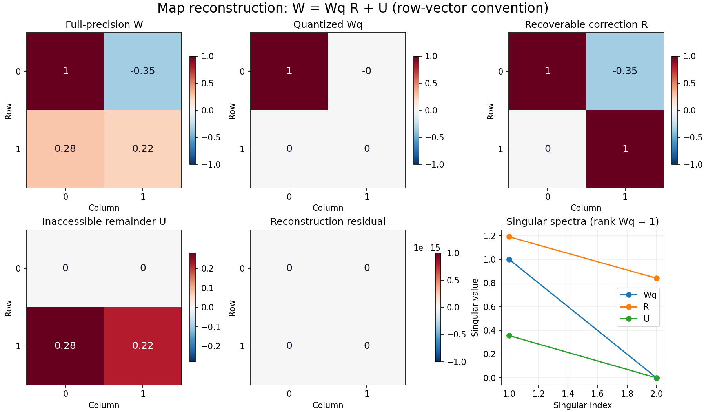
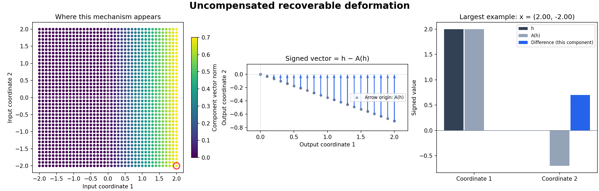
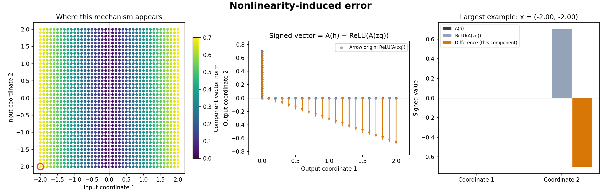
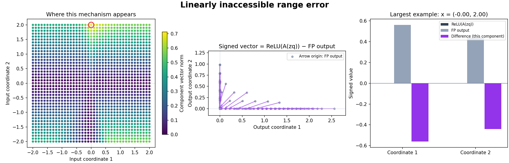
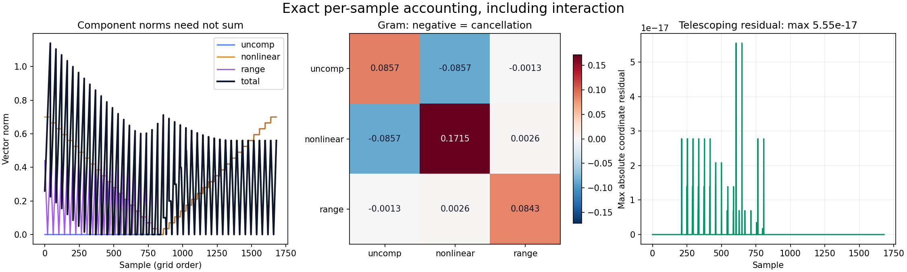
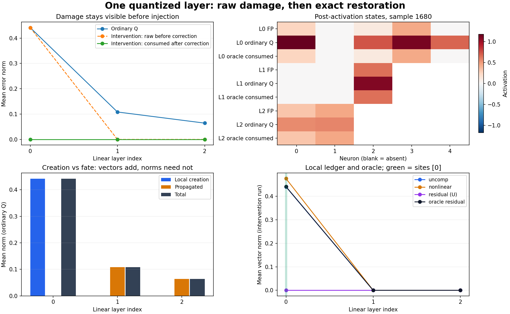
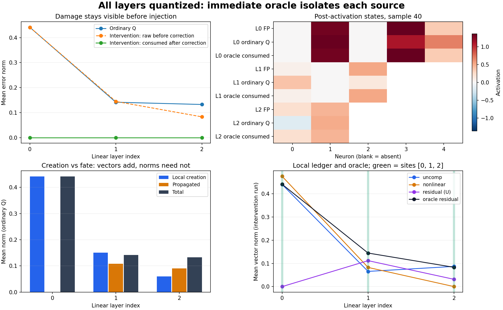
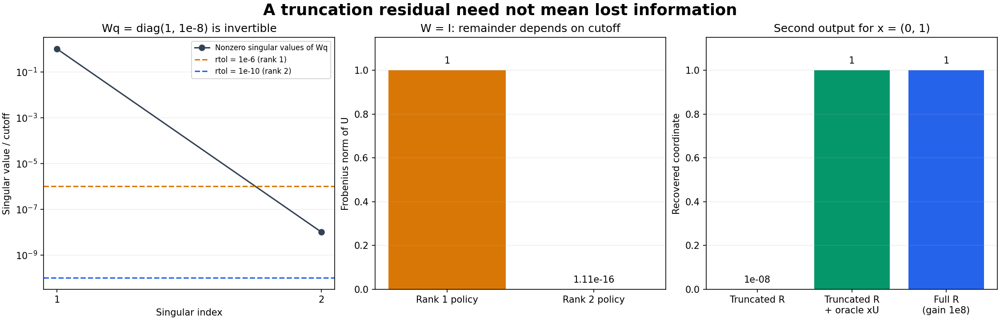

# Quantization geometry: verification and contribution record

This is evidence for the current apparatus and explanatory fixtures. Definitions and interpretation belong in the [research note](quant_geometry_foundations.md); API and reproduction commands are in the [implementation README](quant_geometry_implementation.md).

## Acceptance suite

```sh
MPLCONFIGDIR=/tmp/qgeom-mpl .venv/bin/python -m pytest tests/test_qgeom_geometry_story.py tests/test_qgeom_exact_ledger.py tests/test_qgeom_instrumented_mlp.py tests/test_qgeom_metrics.py tests/test_qgeom_policy.py tests/test_models.py -q
```

The current targeted suite has **77 passing tests**. The geometric fixtures test reversible deformation, a ReLU collision with distinct FP targets, and rank-loss restoration using the input-dependent remainder. Mathematical regression tests include independently specified coordinates, bias handling, truncation, correction-extension dependence, and signed interaction. Runner tests cover single-source and all-layer immediate oracle restoration, delayed-target plumbing, snapshot ownership and unsupported architectures.

## Diagnostic figures and numerical evidence

`experiments/quant_geometry_foundations.py` saves eight figures plus [the run manifest](figures/quant_geometry/run_manifest.json). The manifest records revision/dirty state, seed, package versions, exact model weights and biases, dataset/grid, precision, quantization scales, sites, tolerances and measured residuals. The grid example uses no trained or fitted component, so no train/test split is claimed. The rank-policy audit uses separately prescribed matrices, explicitly identified in the manifest; they are not outputs of the 2-bit quantizer.



**Figure 1.** A bounded 2-bit quantizer maps `W=[[1,-0.35],[0.28,0.22]]` to `Wq=[[1,0],[0,0]]`. The resulting `R=[[1,-0.35],[0,1]]` recovers the first input row. `U=[[0,0],[0.28,0.22]]` retains the second row, which is absent from `Wq`. This example has an exact null direction, so its missing-information interpretation is valid. A full-row-rank widening map has `U=0` in exact arithmetic when no nonzero singular values are discarded.



**Figure 2.** The negative shear in `R` would move a positive quantized first coordinate into a negative second coordinate. The blue arrows are `h-A(h)` (from corrected state to uncorrected state), not correction arrows. The right panel compares the two states and their signed difference at the largest example. These corrected-after-ReLU coordinates may be negative; they are intermediate counterfactual states, not ordinary ReLU outputs.



**Figure 3.** For a positive first input coordinate, ReLU clips the negative second coordinate created by the shear; the orange and blue components cancel. For a negative first coordinate (the selected example in the figure), applying the shear before ReLU creates a positive second coordinate, whereas applying ReLU first removes the input needed to create it. The orange vectors capture both cases. Nonlinear error can therefore cancel another component rather than increase the total norm.



**Figure 4.** The removed second input row changes the FP output while leaving the quantized preactivation unchanged for inputs with the same first coordinate. The purple arrows compare the recovered affine output with the actual FP output. This isolates missing input information from the recoverable shear.



**Figure 5.** Norms are shown separately, the Gram matrix exposes negative cross terms, and the final panel shows the per-sample telescoping residual. In the saved float64 grid experiment its maximum is approximately `5.55e-17`.



**Figure 6.** Only layer 0 of a seeded, untrained `2→5→3→2` MLP is quantized. Ordinary Q inference propagates the damage. The immediate bridge leaves raw damage visible at layer 0, restores its consumed activation, and returns the FP downstream trajectory. The other panels expose the individual sample states, local/propagated accounting, and local component magnitudes. Float biases and activations are preserved.



**Figure 7.** Quantizing every layer while immediately restoring every output gives every layer the FP input. Each raw ledger still records nonzero damage, while consumed states match FP. The saved example's final discrepancy is zero in float32; tests use explicit numerical tolerances rather than demanding universal bitwise equality.

## Implementation contributions

| Contribution | Files | Verification / associated visual |
|---|---|---|
| Bounded weight-only quantization and metadata | `aleph/qgeom/weight_quantizer.py` | Bit bounds, ties, zero weights, deterministic output and snapshot ownership; Figure 1 |
| Recoverable/range map split and diagnostics | `aleph/qgeom/map_decomposition.py` | Rectangular, zero, rank-deficient and explicitly truncated maps; Figure 1 |
| Bias-aware exact creation ledger and interaction summary | `aleph/qgeom/ledger.py` | Per-sample telescoping, affine reconstruction, identity activation, ReLU cancellation and Gram identity; Figures 2–5 |
| Shared traces and model adapter | `aleph/qgeom/instrumented_mlp.py` | FP equivalence, arbitrary layer selection, detached snapshots, biasless/final-ReLU models and unsupported architecture checks; Figure 6 |
| Explicit residual oracle and correction bridges | `aleph/qgeom/instrumented_mlp.py` | Immediate correction at each selected source, all-layer reset of inputs, delayed target sanity check, raw-state preservation and residual sign; Figures 6–7 |
| Reusable plotting and reproducible example | `aleph/qgeom/ledger_plots.py`, `experiments/quant_geometry_foundations.py` | Generated artifacts and manifest; diagnostic Figures 1–8 |

This implements the plan's single-layer foundation and shared MLP/oracle apparatus. The causal tests also establish immediate single-layer and all-layer restoration. Delayed-site plumbing has a sanity test, but fitted correction families, held-out recoverability curves, ordered component propagation and source-specific tracking remain future work. Existing notebook research claims were not revalidated by retraining here.

## Mathematical audit: numerical rank and attribution conventions

The reconstruction, affine-bias, telescoping, Gram-energy, and local/propagated identities defined in the research note were checked algebraically and numerically. The zero-bias coordinate example and a biased example now have independent expected-coordinate tests. Two interpretation limits needed clarification:

**Truncation can create a residual without losing information.** For prescribed `W=I` and `Wq=diag(1,1e-8)`, a cutoff of `1e-6` gives `R=I` and `U=diag(0,1-1e-8)`. Retaining the small singular value instead gives `R=diag(1,1e8)` and `U=0`. The second input coordinate is weakly represented, not absent. In the truncated case, `Wq.T @ U=diag(0,1e-8*(1-1e-8))` is nonzero; only retained-space orthogonality holds.



**Figure 8.** Singular values and both cutoffs, the resulting remainder norms, and recovery of the second output. The rank-2 decoder recovers the FP coordinate from Q alone at gain `1e8`; the truncated correction needs the remainder. This figure distinguishes a numerical policy decision from actual loss through an exact null direction.

**The three components depend on the chosen extension of R.** Take `W=Wq=[[1,-1],[0,0]]` and `x=(1,0)`. The implemented identity-centered choice gives `R=I`, `U=0`, and all errors zero. Alternatively, let `N` have every entry `0.5`. Since `Wq N=0`, `R'=I+N` reconstructs the same weights. Yet `h=(1,0)` gives `hR'=(1.5,0.5)`: uncompensated error is `(-0.5,-0.5)` and nonlinear error is `(0.5,0.5)`. They cancel and total error remains zero. Nonzero components alone therefore do not establish physical information destruction; the declared correction convention matters.

The existing Gram figure (Figure 5) illustrates why signed interaction must be reported alongside component magnitudes. No numerical correction was needed to the original `(1,2)` coordinates or the affine-bias equations.

## Geometric explanation contributions

| Contribution | Source / artifact | Evidence |
|---|---|---|
| Geometric map repair versus post-ReLU reconstruction | `experiments/quant_geometry_reconstruction_comparison.py`; `geometry_repair_vs_reconstruction.png`, `repair_vs_reconstruction_fixture.json` | Research Figure 3 uses the Figure 1 map and the same shape samples; distinct R/C, reversed preference of the two objectives, and least-squares normal-equation residual checked |
| Full-rank rectangular measurement geometry | `aleph/qgeom/geometry_story.py::build_rectangular_measurement_story`, `experiments/quant_geometry_rectangular_measurement.py`; `geometry_rectangular_fibers.png`, `rectangular_measurement_fixture.json` | Independent 3→2 coordinates; rank 2 on both routes; nonzero Q singular values sqrt(3) and 1; constant-Q fiber with different FP outputs and opposite xU terms |
| Scalar measurement projection and rotated fibers without rank loss | `aleph/qgeom/geometry_story.py::build_scalar_measurement_story`, `experiments/quant_geometry_scalar_measurement.py`; `geometry_scalar_fibers.png`, `scalar_measurement_fixture.json` | Two independent coordinate tests: unchanged scalar rank, changed length/direction, orthogonal residual, equal Q readings, distinct FP readings and opposite missing contributions |
| Three controlled grid/circle stories with persistent A/B identities | `aleph/qgeom/geometry_story.py`, `experiments/quant_geometry_visual_story.py`; `geometry_deformation.png`, `geometry_relu.png`, `geometry_loss.png` | Four geometric-claim tests; fixed scales within each sequence; All teaching stories use non-identity Wq; deformation and ReLU cases have independently specified FP/Q probe coordinates |
| Moving view of the same endpoints | `animations/quant_geometry_story.html`; `geometry_story_states.json` | Step controls, full playback, no JavaScript errors, collision label and 360px layout checked |
| Exact pictures for each formal ledger component | `experiments/quant_geometry_ledger_figures.py`; `ledger_geometry_uncomp.png`, `ledger_geometry_nonlinear.png`, `ledger_geometry_range.png` | Figures use the existing ErrorLedger states directly; arrow endpoints are the states in the definitions |
| Signed cancellation path | Same figure generator; `ledger_geometry_cancellation.png` | Coordinates are the independent `(1,2)` regression example; opposite uncompensated/nonlinear vectors share endpoints |
| One research note pairing definitions and geometric explanations | `quant_geometry_foundations.md` | Main narrative: linear map deformation → map repair versus linear calibration → introduce ReLU and its obstruction → post-ReLU reconstruction comparison → relax exact linear repair and complete the two-term account with U → exact ledger → propagation/oracle. Scalar/fiber/rectangular/rank examples and mathematical machinery follow in A/B. API/reproduction belongs to the implementation README; validation/audit/contribution evidence belongs here |

All examples are deterministic teaching fixtures, not measurements of mechanism frequency or task performance in a trained model. No quantization, decomposition, ledger, or oracle algorithm changed in the documentation restructuring.

Research Figure 1's exact inverse repair uses full-precision R with low-bit Wq. An independent check of that fixture in float32 and float64 confirms that R retains W's dtype, agrees with `torch.linalg.solve(Wq, W)`, and has coefficients off Wq's quantization grid. Maximum map residuals are `2.98e-08` and `1.11e-16`, respectively; the exact identity is mathematical, with ordinary floating-point error in its implementation. The seven geometry-story tests pass, including the inverse-system and full-rank rectangular checks. The square-invertible guarantee and the lack of a blanket guarantee for rectangular ANN maps are stated beside the main repair objective; the general criterion remains in the technical appendix.

The reconstruction comparison uses 859 sampled grid/circle points, with equal weight per point (including duplicates); named A/B probes are excluded. R repairs the preactivation map exactly, while its post-ReLU calibration MSE is `0.00517103`. Fitting C lowers that activation MSE to `0.00475163` but leaves a nonzero preactivation map discrepancy. The fixture records both map objectives and both activation objectives. The maximum absolute least-squares normal-equation residual is approximately `7.84e-14`. The script checks all of these distinctions. This comparison illustrates the different objectives on a controlled map; it does not measure held-out recoverability, and the displayed A/B probes are not a held-out study.

## Markdown math compatibility

The research note uses `$...$` inline and `$$...$$` display blocks, as supported by VS Code's built-in Markdown preview. All 33 display equations and 73 inline expressions were parsed by the installed VS Code's bundled KaTeX renderer with `throwOnError: true` and `strict: "error"`; all rendered without errors.

The research Figure A3 rank-collapse explanation additionally checks the independently specified A/B midpoint `(0.4,0.12)` and missing displacements `(-0.2,-0.2)` / `(0.2,0.2)`. A least-squares Pythagorean regression verifies that perturbing R through the repair channel adds nonnegative squared error to the remainder. The revised arrows show xU from the repaired point toward the FP targets.

The square-map geometric test now checks R against an independently solved inverse system. The rectangular fixture keeps its maximum possible rank on both routes; its missing direction is a consequence of the 3→2 measurement channel, with no nonzero singular value discarded. The CNN patch-dimension paragraph describes a pointwise channel repair family; the current shared runner remains an MLP adapter.
